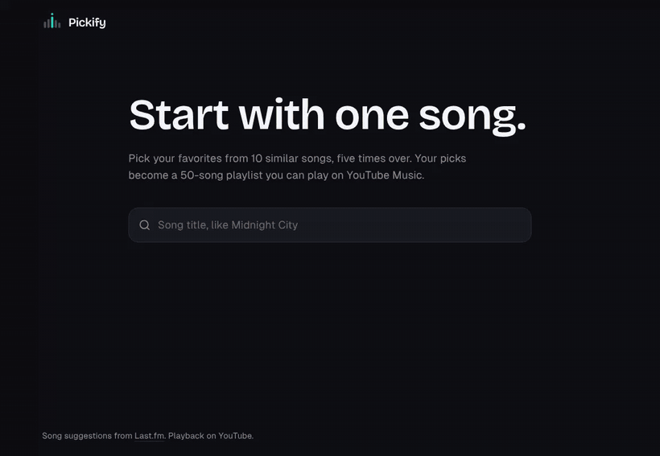
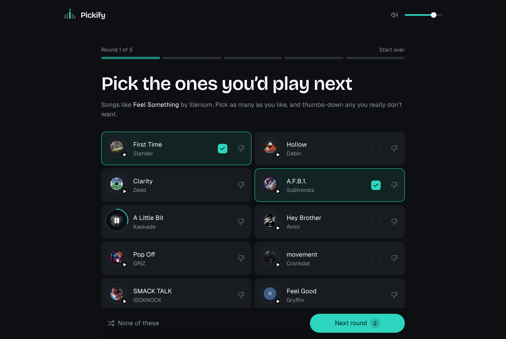
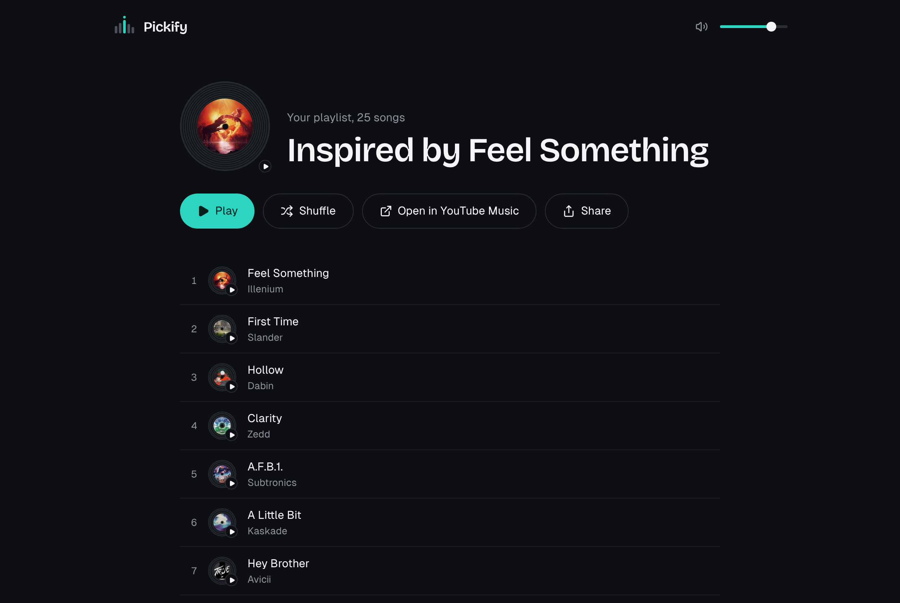
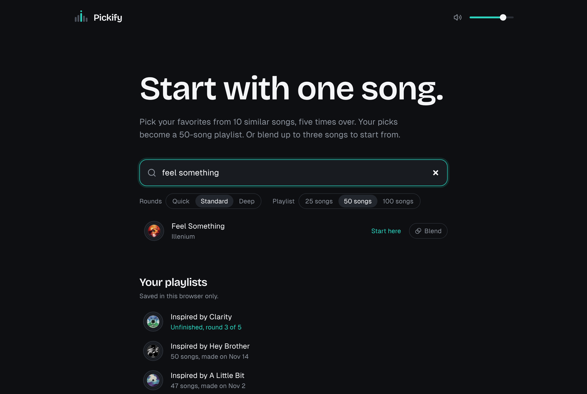
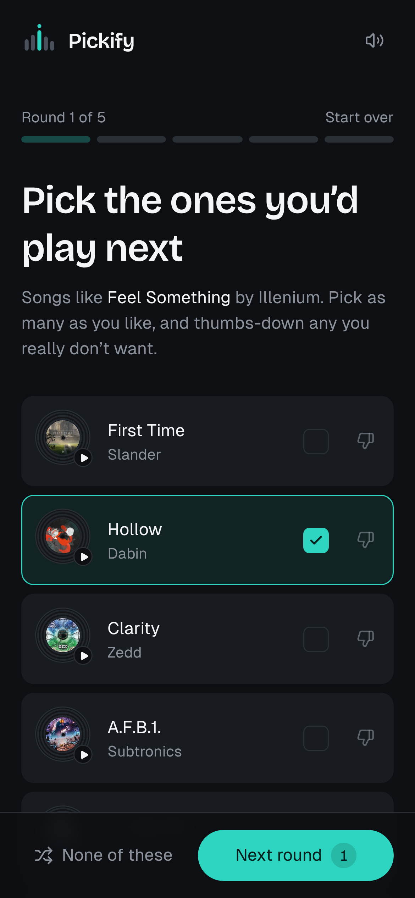
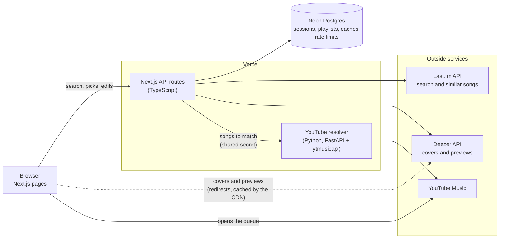

# Pickify

Pick a song you like. Pickify shows you 10 similar songs, you pick as many as you like, and it uses your picks to suggest the next 10. After five rounds it builds a 50-song playlist you can open on YouTube Music, in order or shuffled.

**Live at [pickify.ppeternnguyen.com](https://pickify.ppeternnguyen.com)**



## Features

- **Blend up to three songs** to start from, and choose how long it takes (3, 5 or 8 rounds) and how long the playlist is (25, 50 or 100 songs).
- **Pick as many as you like.** Every picked song pulls in its own similar songs, and songs that keep coming up rise to the top.
- **Hear before you pick.** Tap any record for a 30-second preview.
- **Skips teach it too.** Songs you pass on push similar songs down, and a thumbs-down ("Not for me") pushes them down hard.
- **"None of these"** swaps the round for 10 new songs, and the skipped ones never come back.
- **Edit before you play.** Take songs out of the playlist and put them back.
- **Play right on the page** with YouTube's official player: next, previous, shuffle, and tap any song to play from there.
- **Open in YouTube Music** too, with every song matched to a YouTube upload.
- **Your playlists** are listed on the home page, saved in the browser without an account.
- **Share links** show the playlist's name and the seed song's record in iMessage, Discord, Slack and other apps.

| Picking songs | The playlist |
| --- | --- |
|  |  |

| Search | On a phone |
| --- | --- |
|  |  |

## How it fits together



1. **Search and picking.** The app asks Last.fm for similar songs, scores them in a candidate pool (below) and stores each session and round in Postgres.
2. **Covers and previews.** `/api/art` and `/api/preview` look the song up on Deezer and redirect the browser there. Covers are cached in Postgres and both are cached by Vercel's CDN.
3. **Playing.** The app sends the playlist to the resolver, a separate Python service that searches YouTube Music with `ytmusicapi`. It turns the matches into a YouTube queue link that YouTube Music opens. Matches are cached for 30 days, so replaying a playlist is fast.

## Tech stack

| Layer | Tool |
| --- | --- |
| Frontend and API | Next.js (App Router), TypeScript, Tailwind CSS |
| Song similarity | Last.fm API (`track.getSimilar`) |
| Album art and previews | Deezer API (public, no key) |
| YouTube matching | Python resolver using `ytmusicapi` (in `/resolver`) |
| Database | Neon Postgres (`@neondatabase/serverless`) |
| Tests | Vitest, with PGlite (in-memory Postgres) for database tests |
| Hosting | Vercel (two projects: the app and the resolver) |

## Project layout

```
resolver/             Python service that finds a YouTube video for each song
src/app/              Next.js pages and API routes
src/lib/              Shared logic (Last.fm and Deezer clients, candidate pool, rate limits, database)
src/components/       UI components
db/migrations/        Database schema (applied with npm run db:migrate)
scripts/              Dev scripts
public/               Static assets
assets/fonts/         Fonts for the link preview images (Open Font License)
docs/screenshots/     Images for this README
```

## How recommendations work

1. Last.fm's `track.getSimilar` returns songs similar to each seed, each with a similarity score from 0 to 1. With several seeds, songs similar to more than one of them start ahead, so the rounds begin as a blend.
2. Those songs go into a **candidate pool**. When a song shows up as similar to more than one of your picks, its scores add up, so it rises to the top.
3. Each round shows the 10 highest-scoring songs you haven't seen yet, with at most 2 per artist.
4. After each round:
   - **Picks** add their own similar songs to the pool. Later rounds count more (×1.25 in round 1, up to ×2.25 in round 5).
   - **Skips** (songs you saw and didn't check) take score away from their similar songs. A skip only means "less than the ones I picked", so all of a round's skips together weigh half as much as its picks.
   - **"Not for me"** takes score away from its similar songs as strongly as a pick adds it.
   - **Artists** you skip are ranked lower (×0.75 per skip, ×0.56 for "Not for me", never below ×0.25). Picking one of their songs later cancels that.
   - Skipped and "Not for me" songs are out for good, like "None of these". Songs whose score drops to zero or below stop being suggested.
5. The final playlist is the seeds and your picks first, then the best songs left in the pool that you never passed on, up to the length you chose (25, 50 or 100) with at most 3 per artist. If the pool runs short, the playlist is shorter rather than padded with songs you skipped.

The logic lives in `src/lib/candidatePool.ts`.

## API

All endpoints return JSON. Errors look like `{ "error": { "code": "conflict", "message": "..." } }`, where `message` is safe to show to users. Codes: `invalidRequest` (400), `notFound` (404), `conflict` (409), `noSuggestions` (422), `rateLimited` (429, with a `Retry-After` header), `upstreamUnavailable` (503), `internalError` (500).

| Method | Path | Body | Returns |
| --- | --- | --- | --- |
| `GET` | `/api/tracks/search?q=believe` | | `{ tracks }`: up to 10 songs to pick a seed from |
| `POST` | `/api/sessions` | `{ seeds: [{ artist, title }], rounds?, playlistSize? }` (1 to 3 seeds; rounds 3, 5 or 8, default 5; playlistSize 25, 50 or 100, default 50). The older `{ artist, title }` body still works | Session state with round 1 (201) |
| `GET` | `/api/sessions/:sessionId` | | Session state |
| `POST` | `/api/sessions/:sessionId/picks` | `{ roundNumber, trackKeys, dislikedKeys? }` (1 to 10 picks, plus songs marked "Not for me") | Session state with the next round, or `status: "complete"` and a `playlistId` after the last round |
| `POST` | `/api/sessions/:sessionId/reroll` | `{ roundNumber, dislikedKeys? }` | Session state with 10 new songs for the same round ("none of these") |
| `GET` | `/api/art?artist=&title=` | | Redirects to the album cover (302), or 404 when there isn't one. Used directly as an image source |
| `GET` | `/api/preview?artist=&title=` | | Redirects to a 30-second preview clip (302), or 404 when there isn't one. Used directly as an audio source |
| `GET` | `/api/playlists/:playlistId` | | `{ playlistId, sessionId, title, createdAt, tracks, removedTracks }`, songs in order |
| `PATCH` | `/api/playlists/:playlistId/tracks/:position` | `{ removed: boolean }` | The updated playlist. Takes a song out, or puts it back in its place |
| `POST` | `/api/playlists/:playlistId/export/youtube` | | `{ queue, inOrder, shuffled, trackCount, unresolvedTracks }`. `queue` lists `{ position, videoId }` in playlist order for the on-page player; `inOrder` and `shuffled` are each `{ youtubeUrl, youtubeMusicUrl }`. The playlist page calls this as soon as it opens, so Play and Shuffle play are ready before anyone taps |

**Session state** has the shape `{ sessionId, status, seed, seeds, playlistSize, currentRound, totalRounds, candidates, picks, playlistId }`. `candidates` holds the songs for the current round, and each song is `{ trackKey, artist, title, durationSeconds, imageUrl }`.

Notes:

- **Picks are safe to retry.** Sending the same songs again, in any order, returns the current state. Different songs for a round that's already done return `409 conflict`.
- **Every picked song counts.** Each one adds its similar songs to the pool, and all picks go at the front of the playlist, right after the seed, in the order they were shown.
- **Rerolled songs never come back**, in later rounds or in the playlist.
- **Sessions can end early.** If Last.fm runs out of new suggestions, the session finishes before round 5 instead of showing an empty round.
- **Album covers are cached** in `track_cache`, including songs with no cover (retried after 30 days), and the CDN caches the redirects for 30 days.
- **Preview links expire.** Deezer signs them for about 15 minutes, so `/api/preview` looks them up each time and the CDN keeps the redirect only until just before it expires.
- **Removed songs aren't deleted.** They're marked with `removed_at`, left out of the YouTube queue, and can be put back. The last song can't be removed.
- **Every route is rate limited per client**, with limits per kind of request in `src/lib/rateLimit.ts`. Counts are kept in Postgres against a hashed IP, and requests are allowed if the counter can't be reached.
- **The export only sends songs to the resolver that aren't cached yet**, and it saves new matches for 30 days. `youtubeMusicUrl` is `null` when YouTube doesn't hand back a temporary playlist ID. In that case, use `youtubeUrl`. Both orders come from one request: the songs are matched once and shuffled for the second link.

## Database

Neon Postgres project `pickify` with two branches:

| Branch | Used by |
| --- | --- |
| `main` | Production deployments |
| `dev` | Preview deployments and local development |

The `dev` branch has its own password, so local work and pull request previews never touch production data. The connection strings are already set in Vercel. Production and preview values are write-only Secrets, and the development values come down with `vercel env pull`.

**Migrations** live in `db/migrations` and run with `npm run db:migrate`. The command applies any files that haven't run yet, in order, and records them in a `schema_migrations` table, so it's safe to run again. Requires Node 22 or newer.

- **Locally**, `npm run db:migrate` updates the `dev` branch.
- **On Vercel**, the build command is `npm run db:migrate && npm run build`, so every deployment migrates its own database first. If a migration fails, the build fails and nothing ships.

To change the schema, add a new numbered file such as `db/migrations/0006_add_column.sql`, run `npm run db:migrate` locally, and open a PR. Don't edit a migration that has already been applied.

## Running locally

Local development uses the Neon `dev` branch, a copy of the database with its own password, so nothing you do locally touches production data.

### App

```bash
npm install
npx vercel link                # once, pick the pickify project
npx vercel env pull .env.local # dev database URL, local resolver URL and secret
npm run dev
```

Open http://localhost:3000.

Production secrets are stored in Vercel as write-only Secrets and are never pulled. If `LASTFM_API_KEY` is missing from `.env.local` after pulling, put it in `.env.development.local` instead. Next.js reads that file too, and `vercel env pull` never overwrites it.

### Resolver

The app calls the resolver at `RESOLVER_URL`, which is `http://localhost:8001` locally. Start it with the same `RESOLVER_SECRET` that's in your `.env.local`:

```bash
cd resolver
python -m venv .venv
.venv\Scripts\activate            # macOS/Linux: source .venv/bin/activate
pip install -r requirements.txt uvicorn
```

Then, in PowerShell:

```powershell
$env:RESOLVER_SECRET = "<RESOLVER_SECRET from .env.local>"
uvicorn main:app --reload --port 8001
```

or in macOS/Linux shells:

```bash
RESOLVER_SECRET="<RESOLVER_SECRET from .env.local>" uvicorn main:app --reload --port 8001
```

Check that YouTube searches work:

```bash
curl -H "x-resolver-secret: <secret>" http://localhost:8001/health/youtube
```

You only need the resolver running to test the YouTube export. Search, sessions and playlists work without it.

### Tests

```bash
npm test            # run once
npm run testWatch   # rerun on save
```

The tests cover the candidate pool, sessions and picks, playlists and the YouTube export, the Last.fm, Deezer and resolver clients (with mocked APIs), rate limiting, browser history, the migration script and the database schema. The database tests run in an in-memory Postgres, so you don't need a Neon database to run them.

## Deploying

Pushing to `master` deploys both Vercel projects:

| Project | Root directory | URL |
| --- | --- | --- |
| `pickify` | repo root | https://pickify.ppeternnguyen.com |
| `pickify-resolver` | `resolver` | Called only by the app, with `RESOLVER_SECRET` |

Pull requests get preview deployments of the app that use the `dev` database. To check that the deployed resolver can still reach YouTube, call `/health/youtube` on it with the `x-resolver-secret` header.

## Monitoring

**Usage:** Vercel Web Analytics counts page views without cookies. The `<Analytics />` component is in `src/app/layout.tsx`. Turn it on once for the project, with `npx vercel project web-analytics enable pickify` or in the dashboard under Analytics, and the numbers show up there.

**Error alerts** go to a Discord channel through a webhook:

- **Server errors:** unexpected crashes in the API, Last.fm outages (not "song not found"), and the YouTube matcher failing.
- **Page crashes in someone's browser:** the error page reports them to `POST /api/client-errors`, which is rate limited.

Each problem is sent at most once per 10 minutes, after the response has gone out, so alerts never slow anyone down. They're off unless `DISCORD_ALERT_WEBHOOK_URL` is set, so set it in Production only:

1. In Discord, open a channel's settings, then **Integrations**, **Webhooks**, **New Webhook**, and copy its URL.
2. Run `npx vercel env add DISCORD_ALERT_WEBHOOK_URL production` and paste it, marked as sensitive. Or add it in the Vercel dashboard under Settings, Environment Variables, Production only.
3. Redeploy production.

## Theme

Dark "teal pulse" theme, defined in `src/app/globals.css`. Use the Tailwind classes it creates, such as `bg-surface`, `text-accent`, `text-text-secondary` and `border-border`, instead of hex values.
